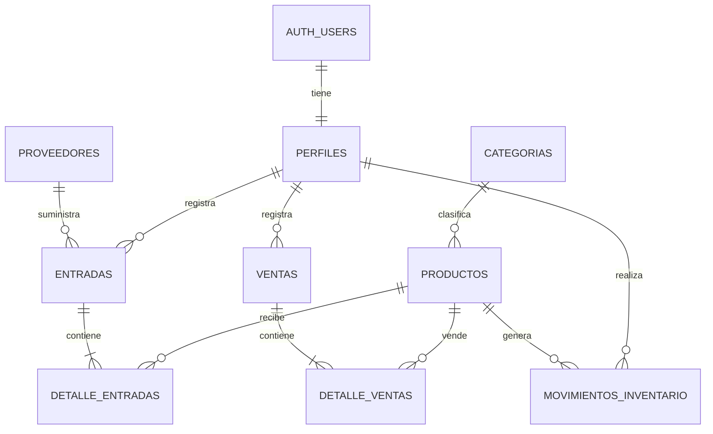

# Diseño y diccionario de la base de datos

## Modelo entidad-relación



`auth.users` es administrada por Supabase Auth. La tabla `perfiles` guarda únicamente los datos adicionales y el rol de cada usuario.

## Diccionario de datos

### perfiles

| Campo | Tipo | Restricción / descripción |
|---|---|---|
| id | uuid | PK y FK a `auth.users.id` |
| nombre | varchar(100) | Obligatorio |
| rol | varchar(20) | `administrador` o `empleado` |
| activo | boolean | Valor inicial `true` |
| creado_en | timestamptz | Fecha automática |

### categorias

| Campo | Tipo | Restricción / descripción |
|---|---|---|
| id | bigint | PK autogenerada |
| nombre | varchar(80) | Único y obligatorio |
| descripcion | text | Opcional |
| activo | boolean | Valor inicial `true` |
| creado_en | timestamptz | Fecha automática |

### proveedores

| Campo | Tipo | Restricción / descripción |
|---|---|---|
| id | bigint | PK autogenerada |
| nombre | varchar(120) | Obligatorio |
| telefono | varchar(25) | Opcional |
| correo | varchar(120) | Opcional |
| direccion | text | Opcional |
| activo | boolean | Valor inicial `true` |
| creado_en | timestamptz | Fecha automática |

### productos

| Campo | Tipo | Restricción / descripción |
|---|---|---|
| id | bigint | PK autogenerada |
| codigo | varchar(50) | Único y obligatorio |
| nombre | varchar(120) | Obligatorio |
| descripcion | text | Opcional |
| categoria_id | bigint | FK a `categorias.id` |
| precio_venta | numeric(12,2) | Mayor o igual a cero |
| stock_actual | integer | Mayor o igual a cero |
| stock_minimo | integer | Mayor o igual a cero |
| activo | boolean | Valor inicial `true` |
| creado_en | timestamptz | Fecha automática |

### entradas

| Campo | Tipo | Restricción / descripción |
|---|---|---|
| id | bigint | PK autogenerada |
| proveedor_id | bigint | FK a `proveedores.id` |
| usuario_id | uuid | FK a `perfiles.id` |
| total | numeric(12,2) | Mayor o igual a cero |
| observaciones | text | Opcional |
| creado_en | timestamptz | Fecha automática |

### detalle_entradas

| Campo | Tipo | Restricción / descripción |
|---|---|---|
| id | bigint | PK autogenerada |
| entrada_id | bigint | FK a `entradas.id` |
| producto_id | bigint | FK a `productos.id` |
| cantidad | integer | Mayor que cero |
| costo_unitario | numeric(12,2) | Mayor o igual a cero |

### ventas

| Campo | Tipo | Restricción / descripción |
|---|---|---|
| id | bigint | PK autogenerada |
| usuario_id | uuid | FK a `perfiles.id` |
| total | numeric(12,2) | Mayor o igual a cero |
| observaciones | text | Opcional |
| creado_en | timestamptz | Fecha automática |

### detalle_ventas

| Campo | Tipo | Restricción / descripción |
|---|---|---|
| id | bigint | PK autogenerada |
| venta_id | bigint | FK a `ventas.id` |
| producto_id | bigint | FK a `productos.id` |
| cantidad | integer | Mayor que cero |
| precio_unitario | numeric(12,2) | Precio guardado al vender |
| subtotal | numeric(12,2) | Cantidad por precio unitario |

### movimientos_inventario

| Campo | Tipo | Restricción / descripción |
|---|---|---|
| id | bigint | PK autogenerada |
| producto_id | bigint | FK a `productos.id` |
| usuario_id | uuid | FK a `perfiles.id` |
| tipo | varchar(20) | `entrada`, `venta` o `ajuste` |
| cantidad | integer | Positiva; el tipo indica el efecto |
| stock_anterior | integer | Stock antes de la operación |
| stock_resultante | integer | Stock después de la operación |
| referencia_tipo | varchar(20) | `entrada`, `venta` o `ajuste` |
| referencia_id | bigint | Identificador de la operación origen |
| observaciones | text | Opcional |
| creado_en | timestamptz | Fecha automática |

## Vista de bajo stock

La alerta no necesita una tabla propia. Puede obtenerse con una vista o consulta que seleccione los productos activos donde:

```sql
stock_actual <= stock_minimo
```

## Integridad y seguridad

- Las entradas y ventas deben confirmarse mediante funciones de PostgreSQL para actualizar el stock como una sola transacción.
- La función de venta debe bloquear la operación si no existe stock suficiente.
- Las políticas RLS deben permitir lectura a usuarios autenticados y limitar las operaciones según el rol.
- La clave `service_role` de Supabase nunca debe incluirse en la aplicación.
- Flutter utilizará únicamente la URL pública y la clave pública/anónima del proyecto; RLS será la protección real de los datos.
- Se crearán índices para `productos.codigo`, `productos.nombre`, fechas y claves foráneas consultadas con frecuencia.

## Respaldo gratuito

El plan gratuito no incluye respaldos automáticos. El equipo exportará periódicamente el esquema y los datos desde Supabase y guardará la copia en una carpeta privada del proyecto. Los archivos con información real o credenciales no deben publicarse en GitHub.
